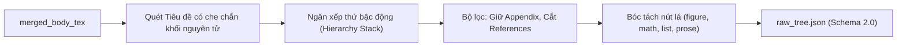

# BÀN GIAO KỸ THUẬT MILESTONE 2 — THÀNH VIÊN 2 (TV2)
## MODULE: PHÂN TÍCH CẤU TRÚC PHÂN CẤP LATEX (HIERARCHY PARSER)

> **Mục đích:** Cung cấp thông tin cốt lõi về thuật toán, ca biên và lược đồ dữ liệu của module `hierarchy.py` để **TV5 (hoặc TV1)** biên tập trực tiếp vào chương mục *Methodology* và *Thống kê dữ liệu* trên Jupyter Book.

---

### 1. TỔNG QUAN VAI TRÒ
- **Vị trí:** Trạm 2 trong pipeline Milestone 2.
- **Đầu vào:** Chuỗi `merged_body_tex` từ Trạm 1 (`gathered.json` của TV1) — đã ghép các file `\input`/`\include` và đã bỏ Preamble, `thebibliography`.
- **Đầu ra:** Cây phân cấp đối tượng `raw_tree.json` (Envelope Schema 2.0) bàn giao cho Trạm 3 (`normalization.py` của TV3).

---

### 2. PHƯƠNG PHÁP & THUẬT TOÁN CỐT LÕI (DÙNG CHO METHODOLOGY)



#### 2.1. Quản lý Thứ bậc Tiêu đề bằng Ngăn xếp (Stack-based Heading Hierarchy)
- **Bảng trọng số thứ bậc LaTeX:**
  $$\text{part (1)} < \text{chapter (2)} < \text{section (3)} < \text{subsection (4)} < \text{subsubsection (5)} < \text{paragraph (6)} < \text{subparagraph (7)}$$
- **Cơ chế hoạt động:**
  - Ngăn xếp lưu `(rank, node_id, is_excluded)`. Nút gốc tài liệu `root` có rank = 0.
  - Khi gặp tiêu đề mới có thứ bậc $r_{\text{new}}$: Lùi (pop) ngăn xếp chừng nào $\text{top.rank} \ge r_{\text{new}}$. Đỉnh ngăn xếp sau khi lùi chính là **nút cha trực tiếp** (`parent_temp_id`).
  - **Xử lý nhảy cấp:** Giải quyết tự nhiên các trường hợp bài báo nhảy từ `\section` thẳng xuống `\subsubsection` mà không làm hỏng quan hệ cây. Độ phức tạp $\mathcal{O}(N)$ theo số lượng tiêu đề.

#### 2.2. Nhận diện Tiêu đề Định dạng có Kiểm soát (Controlled Formatted Headings — PR #17)
- **Vấn đề thực tế:** Bài báo phong cách *Physical Review Letters (PRL)* (như `2411.13795`) không dùng macro `\section`, mà dùng `\textcolor` kết hợp `\textbf` (ví dụ `\textcolor[rgb]{...}{\textbf{Introduction.---}}`). Bộ parser thông thường sẽ bỏ sót và sinh 0 heading.
- **Quy tắc kiểm soát chống bắt nhầm inline:**
  1. Hỗ trợ cấu trúc lồng nhau: `\textcolor` bọc `\textbf` hoặc `\textbf` bọc `\textcolor` (kèm `\noindent` tùy chọn).
  2. **Ranh giới đoạn văn (bắt buộc):** Tiêu đề phải nằm ở đầu đoạn văn (sau dòng trống `\n\n`, `\par`, hoặc `\maketitle`). Mọi cụm in đậm/màu nằm giữa câu văn xuôi đều bị loại bỏ.
  3. **Ràng buộc độ dài:** Độ dài tiêu đề $\le 150$ ký tự, không chứa dòng trống `\n\n`.
  4. **Cấp bậc quy chuẩn:** Gán `heading_rank = 3` (tương đương `section`) để làm cha cho các đoạn văn xuôi bên dưới.

#### 2.3. Quy tắc Bao hàm & Loại trừ
- **Bao hàm:** Giữ lại các mục không đánh số như `\section*{Acknowledgements}`, `\section*{Appendix...}` và đưa vào cây bình thường.
- **Loại trừ triệt để:** Bỏ qua hoàn toàn các nhánh có tiêu đề khớp với `references`, `bibliography`, `works cited`. Toàn bộ nội dung bên trong nhánh này không được sinh vào cây.

#### 2.4. Bóc tách Nút lá & Bảo vệ Khối Nguyên tử
- **Che chắn tiêu đề giả (Shielding):** Hàm `_next_heading()` tự động bỏ qua nội dung trong môi trường `verbatim`, `lstlisting`, `minted`, `\verb` và khối toán, tránh nhận diện nhầm các lệnh tiêu đề nằm trong code hoặc caption.
- **Danh sách lồng nhau đa tầng:** Dùng máy trạng thái đếm độ sâu `env_depth` để chỉ tách `\item` ở cấp 0; các danh sách con (`env_depth > 0`) được giữ nguyên cho đệ quy tầng sâu.
- **Phân loại nút lá:**
  - `figure`: Bắt cả hình ảnh và bảng biểu (`figure`, `table`, `tabular`, `longtable`...). Tự động bóc vỏ các khối căn lề (`center`, `minipage`).
  - `block_formula`: `$$...$$`, `\[...\]` (dùng negative lookbehind `(?<!\\)\\\[` để tránh nhầm ngắt dòng `\\[2pt]`), `equation`, `align`, `gather`...
  - `prose_block`: Các đoạn văn xuôi cách nhau bởi `\n\n` hoặc `\par` (chuyển TV3 tách câu).

---

### 3. HỢP ĐỒNG DỮ LIỆU ĐẦU RA `raw_tree.json`

Vị trí file: `output/parsed/<paper_key>/v<version>/raw_tree.json`

```json
{
  "schema_version": "2.0",
  "arxiv_id": "2411.13795",
  "version": 1,
  "nodes": [
    {
      "temp_id": "v1_root",
      "parent_temp_id": null,
      "position": 0,
      "kind": "document",
      "raw_content": "Version 1 root",
      "level": 0,
      "heading_rank": null
    },
    {
      "temp_id": "v1_n1",
      "parent_temp_id": "v1_root",
      "position": 0,
      "kind": "heading",
      "raw_content": "\\textcolor[rgb]{0.00,0.00,1.00}{\\textbf{Introduction.---}}",
      "level": 3,
      "heading_rank": 3
    },
    {
      "temp_id": "v1_n2",
      "parent_temp_id": "v1_n1",
      "position": 0,
      "kind": "prose_block",
      "raw_content": "First paragraph text...",
      "level": null,
      "heading_rank": null
    }
  ],
  "warnings": []
}
```

* **Quy ước trường:**
  - `temp_id`: Khóa tạm duy nhất trong phiên bản (`v{ver}_{id}`).
  - `parent_temp_id`: Trỏ về cha (nút `document` có cha là `null`).
  - `position`: Thứ tự anh em (0, 1, 2...) trong cùng cha, phục vụ TV4 dựng bảng `occurrences.json`.
  - `kind`: `"document"` | `"heading"` | `"itemize"` | `"item"` | `"figure"` | `"block_formula"` | `"prose_block"`.
  - Không có trường `cleaned_content` (thuộc Trạm 3).
* **Phiên bản rỗng (`no_source` / PDF-only):** Trả về `"nodes": []`, thêm cảnh báo `{"code": "no_tex_source", ...}` và status `no_source`.

---

### 4. ĐOẠN MÃ MẪU PHỤC VỤ TV5 TÍNH TOÁN & VẼ BIỂU ĐỒ BÁO CÁO

TV5 copy đoạn mã dưới đây vào notebook báo cáo để nạp dữ liệu và trực quan hóa:

```python
import json
from pathlib import Path
import pandas as pd
import matplotlib.pyplot as plt
import seaborn as sns

# 1. Đọc tất cả artifact raw_tree.json
records = []
for p in Path("output/parsed").glob("*/v*/raw_tree.json"):
    try:
        data = json.loads(p.read_text(encoding="utf-8"))
    except Exception:
        continue
    arxiv_id = data.get("arxiv_id", p.parent.parent.name)
    version = data.get("version", 1)
    for n in data.get("nodes", []):
        records.append({
            "arxiv_id": arxiv_id,
            "version": version,
            "kind": n["kind"],
            "heading_rank": n.get("heading_rank"),
            "has_parent": n["parent_temp_id"] is not None
        })

df = pd.DataFrame(records)

# 2. Thống kê nhanh
print(f"Tổng số node: {len(df):,}")
print("Phân phối kind:\n", df["kind"].value_counts())

# 3. Biểu đồ 1: Phân phối các loại thành phần cú pháp (Node Kinds)
plt.figure(figsize=(8, 4))
df["kind"].value_counts().plot(kind="bar", color="steelblue")
plt.title("Phân phối thành phần cú pháp (Node Kinds)")
plt.xlabel("Loại thành phần")
plt.ylabel("Số lượng")
plt.yscale("log")
plt.xticks(rotation=30)
plt.grid(axis="y", linestyle="--", alpha=0.5)
plt.tight_layout()
plt.show()

# 4. Biểu đồ 2: Phân phối thứ bậc các tiêu đề (Heading Ranks)
df_h = df[df["kind"] == "heading"].dropna(subset=["heading_rank"])
rank_names = {1: "Part", 2: "Chapter", 3: "Section", 4: "Subsection", 5: "Subsubsection", 6: "Paragraph"}
df_h["rank_label"] = df_h["heading_rank"].astype(int).map(rank_names)

plt.figure(figsize=(7, 3.5))
sns.countplot(data=df_h, x="rank_label", order=[v for v in rank_names.values() if v in df_h["rank_label"].values], palette="Blues_r")
plt.title("Phân phối cấp bậc tiêu đề (Heading Ranks)")
plt.xlabel("Cấp tiêu đề")
plt.ylabel("Số lượng")
plt.tight_layout()
plt.show()
```

---

### 5. SỐ LIỆU KIỂM CHỨNG & HIỆU NĂNG

- **Kiểm thử module:** 42/42 tests pass (`tests/parsing/test_hierarchy.py` + `test_hierarchy_regressions.py`), thời gian thực thi $< 0.35$ giây.
- **Kiểm thử hệ thống:** 368 tests toàn repo pass 100%.
- **Hiệu năng:** Duyệt tuyến tính đơn luồng $\mathcal{O}(L)$, thời gian xử lý trung bình $< 0.015$ giây/file TeX, tiêu thụ RAM $< 5\text{ MB}$/bài báo.
- **Các PR phụ trách:** PR #10 (Hiện thực module ban đầu), PR #17 (Sửa lỗi tiêu đề định dạng PRL `2411.13795`).
